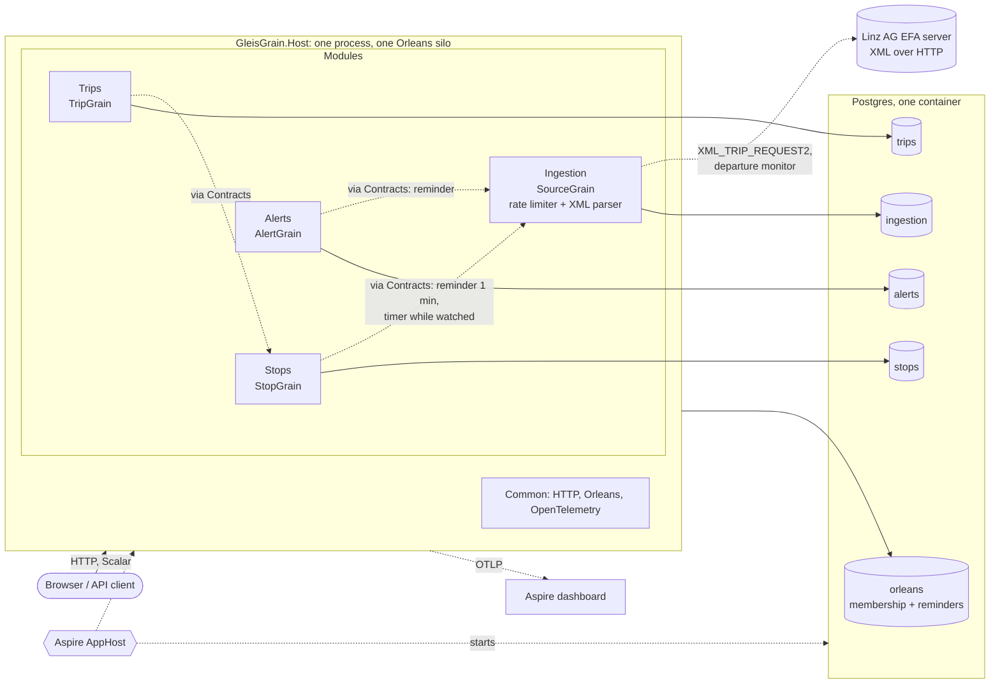

# Architecture

Mermaid source. In Excalidraw use "Insert > Mermaid to Excalidraw" and paste the diagram block.
Dashed arrows are planned, not built yet.

Modules call each other through the `Contracts` projects only. Several replicas of the host form one Orleans cluster of identical silos. Splitting a module into its own deployable later needs only a small host that calls its `Add...Module` and `Map...Endpoints`.
