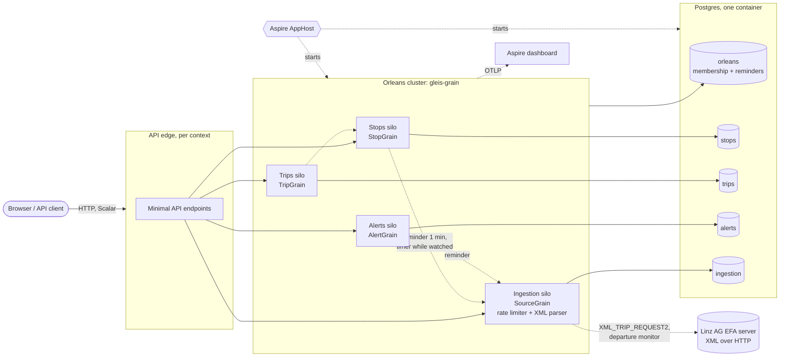

# Architecture

Mermaid source. In Excalidraw use "Insert > Mermaid to Excalidraw" and paste the diagram block.
Dashed arrows are planned, not built yet.

Silos of different contexts join the same cluster and call each other through the `Contracts` projects only.
